# VHDL Parser Module

## Project: Kmila-9s

This module is a core component of **Kmila-9s**, a project officially titled "Aplicación Multiplataforma para el Aprendizaje y Depuración de Código VHDL sin Requerimiento de Hardware Físico" (Multiplatform Application for Learning and Debugging VHDL Code without Requiring Physical Hardware).

**Author:** Ulrich Tamayo Daniel  
**Email:** dulricht1700@alumno.ipn.mx
**Email 2:** danielulrichtamayo@gmail.com
**Version:** 1.3.0 (branch `v1.3.0`)
**Last Updated:** 2026-08-03

> **Docs sync 2026-09-24** — no functional change to this module this cycle; the
> 2026-09-23 feature batch (v1.27.0) is **app-only** (see `App/Kmila/README.md` §19).

---

## 1. Project Overview

The primary goal of this project is to develop a free, open-source, and multiplatform desktop application for the interactive debugging of VHDL code. The application aims to facilitate the learning of digital design by providing a unified environment for simulation and real-time visualization of digital signals, clock cycles, and port states, completely eliminating the need for physical hardware like FPGAs.

### Key Motivations
*   **Accessibility:** Overcoming the financial barrier of expensive FPGA boards and proprietary software licenses.
*   **Pedagogical Improvement:** Offering an intuitive, integrated graphical interface that simplifies the debugging process, unlike the fragmented command-line workflows of tools like GHDL and GTKWave.
*   **Flexibility:** Providing a self-contained application that runs locally on multiple operating systems (Windows, macOS, Linux, Android, iOS) without requiring an internet connection.

This project is built using .NET and MAUI, ensuring a modern and maintainable codebase with broad platform support.

## 2. The Parser Module

This specific module, the **VHDL Parser**, serves as the foundational first step in the simulation pipeline. Its sole responsibility is to read raw VHDL source code (`.vhdl` files) and transform it into a structured, in-memory representation using C# classes. This structured data is then passed to the simulation engine for execution and analysis.

The parser is designed to be robust, handling complex VHDL syntax and providing clear error messages for invalid code.

### Core Responsibilities
*   **Lexical Analysis:** Breaking down the raw VHDL code into a stream of individual tokens (keywords, identifiers, operators, literals, etc.).
*   **Syntactic Analysis:** Validating the sequence of tokens against the VHDL grammar rules to understand the code's structure.
*   **Abstract Syntax Tree (AST) Generation:** Building a tree-like structure of C# objects that represents the VHDL design, including its entities, architectures, signals, processes, and sequential statements.
*   **Scope Management:** Tracking all declared identifiers (signals, variables, ports, etc.) and the scope in which they are valid (e.g., entity, architecture, process).

## 3. Architecture of the Parser Module

The parser is built with a modular, object-oriented design where different classes are responsible for parsing specific parts of the VHDL language.

### Key Components

*   **`Tokenizer.cs`**: The first stage of the pipeline. It reads a `.vhdl` file or a raw string, removes comments, and uses regular expressions to split the code into a list of raw string tokens. It then evaluates these tokens to classify them into types (e.g., `KEYWORD`, `IDENTIFIER`) and creates a list of `Token` objects.

*   **`TokenStream.cs`**: A wrapper around the list of `Token` objects generated by the `Tokenizer`. It provides a stream-like API (`Current`, `Previous`, `MoveNext`, `Expect`, `Match`, `SetRollBack`, `RollBack`) that allows the parser classes to easily consume and validate tokens in sequence. Also includes `StreamerException` for detailed token-related error reporting.

*   **`Parser.cs`**: The main orchestrator. It initializes the `TokenStream` and delegates the parsing of top-level VHDL design units (`entity`, `architecture`, `package`) to their specialized parser classes. `ParseV2()` additionally handles **`library` / `use` clauses** anywhere between design units (multiple library declarations are tolerated) and walks **`configuration` blocks** in-place via `ParseConfigurationBlock()` / `ParseConfigurationBody()` — including the `for CompLabel : CompType use entity work.X(Arch);` binding form.

*   **Structural Parsers (`IParseStructures`)**:
    *   **`EntityParser.cs`**: Parses an `entity` block, including its name and delegations for `generic` and `port` blocks.
    *   **`ArchitectureParser.cs`**: Parses an `architecture` block, including its header (signal/constant declarations) and body (processes, concurrent statements).
    *   **`PackageParser.cs`**: Parses `package` and `package body` declarations.

*   **Declaration Parsers (`IParseDeclarations`)**:
    *   **`PortsParser.cs`**: Handles the `port (...)` block within an entity, creating `Variable` objects for each port.
    *   **`GenericParser.cs`**: Handles the `generic (...)` block, parsing generic constants.
    *   **`ArchitectureAssignationParser.cs`**: Parses declarations in an architecture's header, such as `signal` and `constant`.

*   **Statement & Expression Parsers**:
    *   **`DataStructuresParser.cs`**: A versatile parser for sequential statements found inside processes, functions, and architecture bodies. It can parse `if-then-elsif-else`, `case-when`, `for-loop`, `while-loop`, `exit`, `wait`, `null`, `return`, and signal/variable assignments. Supports both concurrent and sequential statement contexts.
    *   **`FunctionParser.cs`**: Parses function declarations including parameters, return types (with complex bounds), local variable declarations, and function bodies with sequential statements.
    *   **`FunctionAssignationParser.cs`**: Parses the parameter declarations within a function signature.
    *   **`VectorParser.cs` & `RangeParser.cs`**: Helper parsers that handle specific syntax for vector types (e.g., `std_logic_vector(7 downto 0)`, `signed`, `unsigned`) and ranges (e.g., `integer range 0 to 255`). Also handles vector attributes like `'length`, `'range`, `'high`, `'low`.

### Core Data Models

*   **`Token.cs`**: Represents a single lexical unit from the source code. It contains its `Value` (e.g., "entity", "clk"), `Type` (e.g., `KEYWORDS`), and location (`Line`, `Col`).

*   **`Variable.cs`**: A crucial class that represents any named object in VHDL (a signal, port, variable, or constant). It stores its `Name`, data `Type`, `Value`, and `Size`. It also includes an `OnValueChange` event to notify the simulation engine of updates. **2026-06-22 addition:** `ElementSize` + `ArrayLength` carry the per-element width and slot count for array-typed signals (e.g. `signal mem : rom_t` where `rom_t = array(0 to 7) of std_logic_vector(7 downto 0)` lands as `ElementSize=8`, `ArrayLength=8`). `DeferredIndex` / `DynamicIndex` consult these to slice element-wise on `mem(N)` reads — without them the indexer fell back to per-bit reads and returned garbage. **2026-10-06 addition (declared-range fix):** `LeftBound` / `RightBound` / `IsDownto` record a vector's declared range exactly as written (`(7 downto 0)` → left 7, right 0, downto; `(0 to 7)` → left 0, right 7, to), and the helpers `IndexToOffset(index, valueLength)` / `SliceToSpan(high, low, valueLength)` translate a VHDL index into a position in the MSB-first value string honouring that range. When the range is unset (`HasDeclaredRange == false`) they fall back to `valueLength-1-index`, i.e. the conventional `(Size-1 downto 0)` form, so legacy behaviour is byte-identical. This is what lets the engine resolve ascending (`0 to N`) and non-zero-low-bound (`15 downto 8`) vectors correctly instead of bit-reversing them. **Watch out:** `Variable` overloads `operator==` to compare names (not references), so always use `is null` / `is not null` for reference checks.

*   **`Constants.cs`**: A static class that centralizes all constants used by the parser, including:
    *   `enum TYPE`: Defines all possible token types.
    *   `enum DATATYPES`: Defines all supported VHDL data types.
    *   Regular expressions for identifying each token type.

*   **`ParserException.cs`**: A custom exception class used to report detailed syntax and semantic errors during parsing, including:
    *   Line and column numbers (1-based) for error location
    *   Context information (the token value where the error occurred)
    *   Predefined error codes (`INITIALIZATION`, `DUPLICATE_DECLARATION`, `MISSING_STRUCTURE`, `DUPLICATE_STRUCTURE`, `MISSING_DECLARATION`, `SYNTAX_ERROR`)
    *   Factory methods for common errors: `UnexpectedToken()`, `UndeclaredVariable()`, `TypeMismatch()`

### Supported VHDL Constructs

The parser supports a comprehensive set of VHDL language features:

*   **Top-level Structures**: `entity`, `architecture`, `package`, `package body`, `configuration`
*   **Declarations**: `signal`, `constant`, `variable`, `attribute`, `alias`, `component`, `disconnect`, `type`, `subtype`
*   **Custom Types**: `record` types (with field declarations), `array` types (with index constraints), enumeration types, subtypes with constraints
*   **Port and Generic**: Full port/generic declarations with vector types, ranges, and default values
*   **Sequential Statements**: `if-then-elsif-else`, `case-when`, `for-loop`, `while-loop`, `exit`, `wait`, `null`, `return`
*   **Concurrent Statements**: Signal assignments, component instantiations with `port map` and `generic map`
*   **Generate Statements**: `for-generate`, `if-generate`, nested generates with local signal/constant declarations
*   **Block Statements**: Full block statement support with guard expressions, local declarations, and nested blocks
*   **Labeled Constructs**: Labeled processes, labeled generate statements, labeled component instantiations, labeled blocks
*   **Functions**: Function declarations with parameters, local variables, return type bounds (including complex expressions), and complex expressions
*   **Expressions**: Arithmetic (`+`, `-`, `*`, `/`, `mod`, `**`), logical (`and`, `or`, `xor`, `nand`, `nor`, `xnor`, `not`, `sll`, `srl`, `sla`, `sra`, `rol`, `ror`), comparison (`=`, `/=`, `<`, `>`, `<=`, `>=`)
*   **Vector Operations**: Indexed access (e.g., `signal(7 downto 0)`, `signal(i)`), vector attributes (e.g., `A'length`, `A'range`, `A'reverse_range`, `A'high`, `A'low`, `A'left`, `A'right`, `A'ascending`, `A'event`, `A'last_value`, `A'stable`, `A'quiet`, `A'active`, `A'transaction`) — `A'high`/`A'low`/`A'left`/`A'right`/`A'ascending` and `A'range` honour the declared `to`/`downto` direction and bounds (2026-10-06)
*   **Data Types**: `std_logic`, `std_logic_vector`, `integer`, `boolean`, `bit`, `bit_vector`, `natural`, `positive`, `signed`, `unsigned`, `std_ulogic`, `std_ulogic_vector`, `boolean_vector`, `integer_vector`, `character`, `string`, `time`, `real`
*   **Special Constructs**: `rising_edge`, `falling_edge`, aggregate expressions (e.g., `(others => '0')`), function calls in bounds (e.g., `clog2(N)`), concatenation operator (`&`), `after` timing specifications with time units (`fs`, `ps`, `ns`, `us`, `ms`, `sec`, `min`, `hr`)

### Standard Library Functions

The parser recognizes the following IEEE standard library functions (these do not require explicit declaration):

| Category | Functions |
|----------|-----------|
| **IEEE.numeric_std Conversion** | `to_unsigned`, `to_signed`, `to_integer`, `unsigned`, `signed` |
| **IEEE.numeric_std Resize/Shift** | `resize`, `shift_left`, `shift_right` |
| **IEEE.std_logic_1164** | `std_logic_vector`, `std_ulogic_vector`, `to_stdlogicvector`, `to_stdulogicvector`, `to_bit`, `to_bitvector`, `to_x01`, `to_x01z`, `to_ux01` |
| **Math Functions** | `clog2`, `log2`, `ceil`, `floor`, `abs`, `minimum`, `maximum` |
| **Type Conversions** | `conv_integer`, `conv_unsigned`, `conv_signed`, `conv_std_logic_vector`, `integer`, `natural`, `positive`, `real`, `boolean`, `bit`, `character`, `string` |
| **Edge Detection** | `rising_edge`, `falling_edge` |
| **IEEE.math_real** | `sqrt`, `sin`, `cos`, `tan`, `exp`, `log`, `pow` |
| **Other** | `now`, `time` |

### Block Statement Support

Block statements provide a way to group concurrent statements with optional guard expressions and local declarations:

```vhdl
my_block : block (guard_signal = '1') is
    signal local_sig : std_logic;
begin
    guarded output <= input;
end block my_block;
```

**Supported features:**
*   Guard expressions (optional)
*   Local signal/constant declarations within blocks
*   Nested blocks (blocks inside blocks)
*   Labeled blocks with optional end labels
*   Guarded signal assignments with the `guarded` keyword

### Custom Type Support

The parser supports user-defined types including records, arrays, and enumerations:

```vhdl
-- Record type declaration
type ComplexNumber is record
    re : signed(15 downto 0);
    im : signed(15 downto 0);
end record;

-- Array type declaration
type MemoryArray is array (0 to 255) of std_logic_vector(7 downto 0);

-- Enumeration type declaration
type State is (IDLE, RUNNING, STOPPED, ERROR);

-- Subtype declaration
subtype SmallInt is integer range 0 to 100;
```

**Supported features:**
*   Record types with multiple fields of various data types
*   Array types with index constraints (using `to` or `downto`)
*   Enumeration types with named constants (added to scope automatically)
*   Subtype declarations with range constraints

### Component Instantiation

The parser fully supports component instantiations with port and generic mappings:

```vhdl
-- Component declaration in architecture header
component Adder
    generic (WIDTH : integer := 8);
    port (
        A, B : in std_logic_vector(WIDTH-1 downto 0);
        Sum  : out std_logic_vector(WIDTH-1 downto 0)
    );
end component;

-- Component instantiation
U1 : Adder
    generic map (WIDTH => 16)
    port map (A => input_a, B => input_b, Sum => result);
```

### Scope Naming Convention

Architecture scopes use the naming convention `{entityName}_{archName}` to support multiple architectures with the same name for different entities:

```
Entity "Adder" with architecture "Behavioral" → scope key: "Adder_Behavioral"
Entity "Counter" with architecture "Behavioral" → scope key: "Counter_Behavioral"
```

### TokenStream Rollback Feature

The `TokenStream` class provides rollback capability for backtracking during parsing:

```csharp
// Mark current position
stream.SetRollBack();

// Try to parse something
try {
    ParseComplexConstruct();
} catch {
    // Restore to marked position if parsing fails
    stream.RollBack();
    ParseAlternativeConstruct();
}
```

## 4. How to Use This Module

To use the parser, you instantiate the main `Parser` class, providing it with the path to a VHDL file. Then, you call the `ParseV2()` method to begin the process.

```csharp
using Parser.Repositories;
using System;

try
{
    // 1. The Tokenizer reads the file and performs lexical analysis.
    Tokenizer tokenizer = new("path/to/your/design.vhdl");

    // 2. The Parser class orchestrates the syntactic analysis.
    Parser vhdlParser = new(tokenizer);
    vhdlParser.ParseV2();

    // 3. After parsing, the results are available in the Scopes dictionary.
    // This dictionary contains all entities, architectures, and their declared variables.
    var scopes = vhdlParser.GetScopes();

    Console.WriteLine("Parsing completed successfully!");

    // You can now inspect the parsed data structures.
    foreach (var scope in scopes)
    {
        Console.WriteLine($"Scope: {scope.Key}");
        foreach (var variable in scope.Value)
        {
            Console.WriteLine($"  - Variable: {variable.Name}, Type: {variable.Type}");
        }
    }
}
catch (Exception ex)
{
    Console.WriteLine($"An error occurred during parsing: {ex.Message}");
}
```

## 5. Dependencies

This module relies on the following .NET libraries:
*   `Microsoft.Extensions.Logging`: For logging information and errors during the parsing process.

All other code is self-contained within this project module.

## 6. Parser Flow and Class Relationships

To better understand the parser's internal workings, the following diagrams illustrate the data flow, class relationships, and sequence of operations.

### 6.1. High-Level Parsing Flow

This diagram shows the overall process, starting from the raw VHDL file and ending with the structured `Scopes` dictionary that the simulation engine can use.

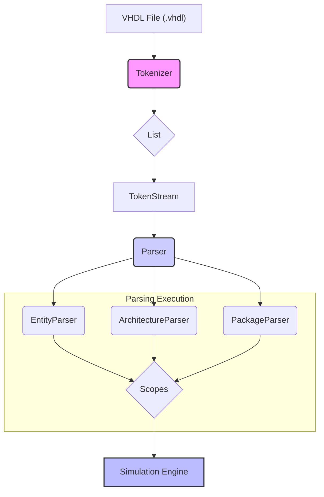

### 6.2. Detailed Class Diagram

This diagram details the composition and inheritance relationships between the key classes in the parser module. It highlights how specialized parsers are composed to handle different parts of the VHDL syntax.

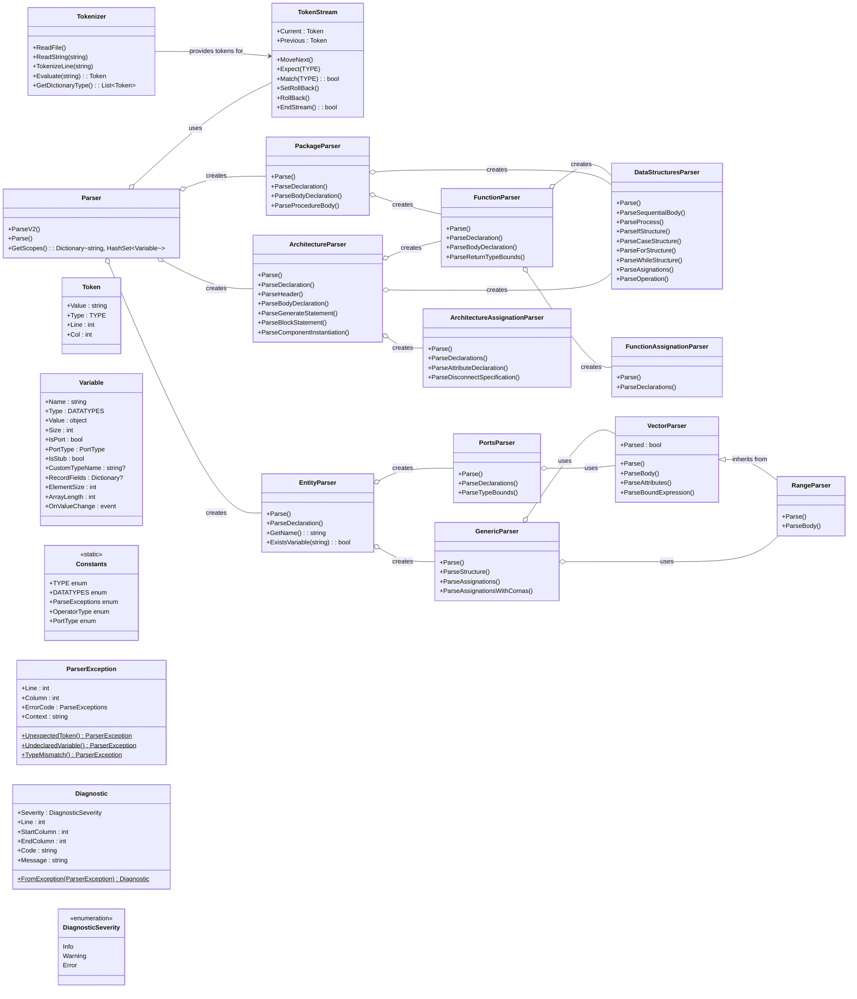

### 6.3. Sequence Diagram: Parsing an Entity

This sequence diagram shows the runtime interactions between objects when the `ParseV2()` method encounters an `entity` block in the VHDL code.

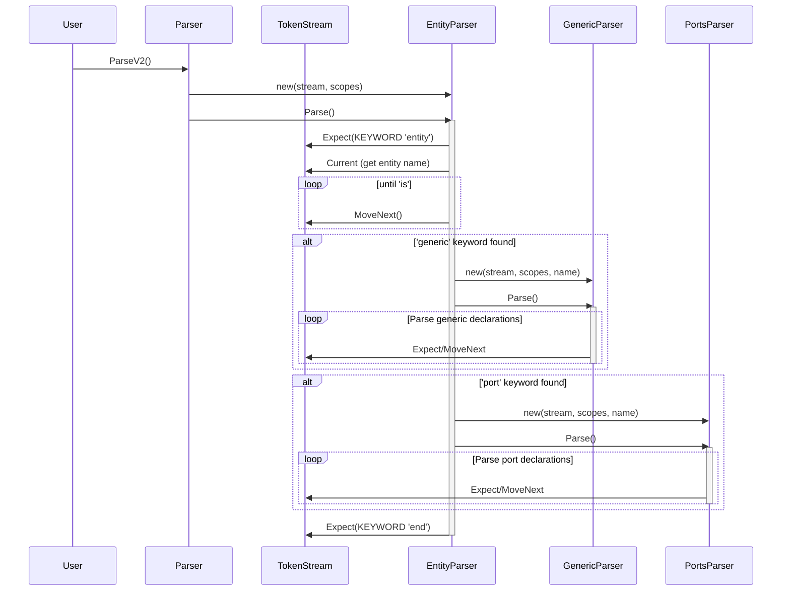

### 6.4. Module Diagram
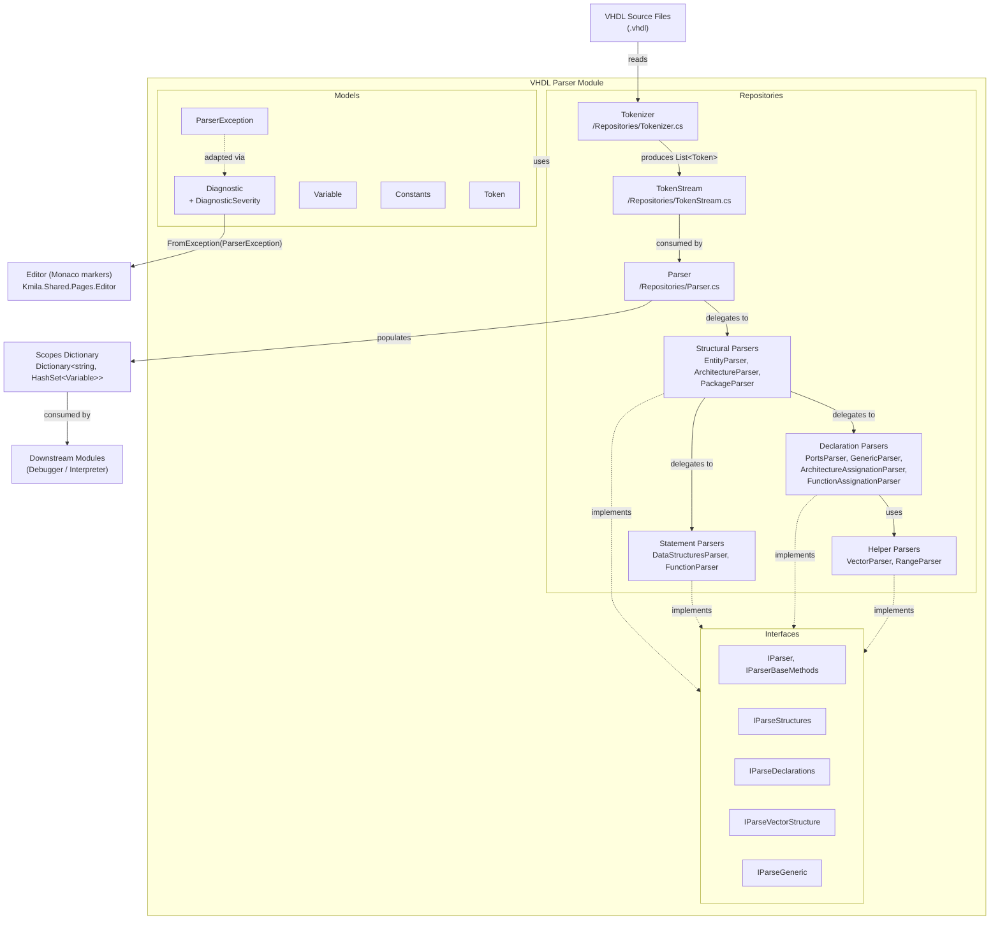

## 7. Changelog

### Documentation re-sync (2026-08-03, branch `v1.3.0`)

*   Updated the header stamp to the current branch (`v1.3.0`) and date. Re-checked the class reference against the on-disk tree: added `ParserSkipOverflowException` and `Diagnostic` to the Models table, `SharedLogging` to the Parsers table, and a new Services table for `UserTypeRegistry` / `ParseProfile`. Refreshed the "Strictness pass" negative-fixture list to include the third fixture (`test_negative_garbage_in_body.vhdl`), which `Program.cs` already wires. Documentation only — no parser source or public API changes.

### Version 1.14.1 (2026-05-01)

#### Documentation Verification

*   **README.md**: Cross-checked the entire document against the current `Repositories/`, `Models/`, and `Interfaces/` source. Confirmed that the orchestrator entry points are still `Parser(Tokenizer)` / `Parser(string FilePath)`, with `ParseV2()` as the recommended path and `Parse()` retained as the legacy monolithic implementation. The full `IParser` set documented here matches the `*.cs` files on disk one-to-one (14 parser classes, 6 interfaces, 5 model files including `Diagnostic`).
*   **§2 Architecture / `Parser.cs`**: Clarified that `ParseV2()` also handles inline `library`/`use` declarations between design units and walks `configuration` blocks (with the `for CompLabel : CompType use entity work.X(Arch);` binding form) via `ParseConfigurationBlock` / `ParseConfigurationBody`. Earlier versions of this document only mentioned `entity` / `architecture` / `package` switching.
*   **§6.2 Class diagram**: Added the `Diagnostic` model (with `FromException(ParserException)` static adapter) and the `DiagnosticSeverity` enumeration to the Models cluster.
*   **§6.4 Module diagram**: Added the `Diagnostic` / `DiagnosticSeverity` node to the Models subgraph and an explicit edge into the editor surface (`Kmila.Shared.Pages.Editor`) showing how `ParserException` is adapted via `Diagnostic.FromException(...)` to feed Monaco markers.
*   No public API or runtime behavior changes in this release; the parser surface remains backwards-compatible with the v1.14.0 release that introduced the diagnostics pipeline.

---

### Version 0.13.1 (2026-02-21)

#### Documentation Enhancements

*   **Variable.cs**: Added comprehensive XML documentation for all constructors, operators, backing fields (`_size`, `_value`), `IsPort`, `PortType`, `ToString()`, implicit conversion, and equality/inequality operators
*   **DataStructuresParser.cs**: Added XML docs for `ParseDeclaration()` (throws NotImplementedException), and documented private field groups
*   **VectorParser.cs**: Added XML docs for `CheckVariable()` protected method and `IsVector()` private method
*   **TokenizerTests.cs**: Added XML documentation for test class and test method with parameter descriptions
*   **Program.cs**: Added XML documentation for the test runner class and its entry point

---

### Version 0.13.0 (2025-12-13)

This version includes comprehensive documentation improvements, bug fixes, and minor code enhancements.

#### Bug Fixes

*   **Memory Leak Fix in TokenStream**: Fixed significant memory leak caused by each `TokenStream` instance creating its own `LoggerFactory`. Now uses a static shared `LoggerFactory` to prevent memory accumulation during repeated parsing operations.

#### Documentation Enhancements

*   **README Updates**: Added comprehensive documentation for previously undocumented features:
    *   Standard Library Functions: Complete table of 50+ recognized IEEE standard library functions
    *   Block Statement Support: Detailed explanation with VHDL code examples
    *   Component Instantiation: Full documentation with generic/port map examples
    *   Scope Naming Convention: Explanation of `{entityName}_{archName}` pattern
    *   TokenStream Rollback Feature: Usage documentation with code examples

*   **Constants.cs Documentation**: Added XML documentation to all enum values and regex patterns:
    *   `TYPE` enum: Each token type now has detailed description
    *   `ParseExceptions` enum: Each error code has explanation with examples
    *   `DATATYPES` enum: Each data type has description of its VHDL semantics
    *   `OperatorType` enum: Each operator category is documented
    *   `PortType` enum: Input/output port descriptions
    *   All regex patterns: Added examples and explanations for each pattern

#### Updates (from 2025-12-09)

*   **Shift/Rotate Operators in LOGIC_OPERATORS**: Added `sll`, `srl`, `sla`, `sra`, `rol`, `ror` to the `LOGIC_OPERATORS` regex pattern. These operators were already in KEYWORDS but were not classified as logical operators, causing issues in the Interpreter's expression evaluation.

---

### Version 0.12.5 (2025-12-09)

This version adds shift and rotate operators to LOGIC_OPERATORS for proper classification by downstream interpreter.

#### Updates

*   **Shift/Rotate Operators in LOGIC_OPERATORS**: Added `sll`, `srl`, `sla`, `sra`, `rol`, `ror` to the `LOGIC_OPERATORS` regex pattern. These operators were already in KEYWORDS but were not classified as logical operators, causing issues in the Interpreter's expression evaluation.

---

### Version 0.12.5 (2025-12-09)

This version fixes the remaining test failures (tests 18, 19, 20) and adds support for advanced VHDL constructs including block statements, guarded signals, signal attributes, and complex conditional generates.

#### New Features

*   **Block Statement Support**: Full parsing of VHDL block statements with:
    *   Guard expressions (e.g., `block (guard_signal = '1')`)
    *   Local signal/constant declarations within blocks
    *   Nested blocks (blocks inside blocks)
    *   Labeled blocks with optional end labels
*   **Guarded Signal Assignments**: Support for guarded concurrent signal assignments with the `guarded` keyword
*   **Signal Attributes with Arguments**: Parsing of signal attributes with time arguments:
    *   `'stable(time)` - signal stability check
    *   `'delayed(time)` - delayed signal value
    *   `'last_value`, `'last_event`, `'event` in conditional expressions
*   **Type Conversion Functions in Conditionals**: Support for IEEE numeric_std type conversion functions in if/when conditions:
    *   `unsigned()`, `signed()`, `to_integer()`, `to_unsigned()`, `to_signed()`
    *   `resize()`, `shift_left()`, `shift_right()`
    *   `std_logic_vector()`, `integer()`, `natural()`
*   **Configuration Architecture Binding**: Support for architecture specification in configuration blocks:
    *   `use entity work.Component(Architecture);` syntax
*   **Enhanced Operator Support**: Added `/=` (not-equal) and `>=` (greater-equal) as properly tokenized operators
*   **Package Constants in Generics**: Generic default values can now reference package constants (identifiers), not just literals
*   **Custom Types in Ports**: Port declarations now accept user-defined types (identifiers) in addition to standard VHDL types

#### Bug Fixes

*   **Fixed infinite loop in `ParseOperation()`**: Corrected while loop condition that prevented proper termination on semicolon
*   **Fixed `QUALIFIED_IDENTIFIERS` regex**: Now allows digits in the first identifier segment (e.g., `s_axi_s2m.bvalid` where `s2m` contains a digit)
*   **Fixed nested block parsing**: `ParseBlockBody()` now properly recognizes and handles nested block statements
*   **Fixed configuration block parsing**: Added support for architecture binding syntax with parentheses
*   **Added fallback for unknown tokens**: `ParseSingleStatement()` now gracefully skips unknown tokens to the next semicolon instead of causing infinite loops

#### Test File Fixes

*   **test20.vhdl**: Fixed VHDL identifier case conflicts by renaming state machine constants:
    *   `TX_DATA` → `TX_ST_DATA` (to avoid conflict with `tx_data` signal)
    *   `RX_DATA` → `RX_ST_DATA` (to avoid conflict with `rx_data` signal)
    *   Similar renames for `TX_IDLE`, `TX_START`, `TX_STOP`, `RX_IDLE`, `RX_START`, `RX_STOP`

#### Test Coverage

*   All 43 test cases now pass:
    *   test1-10: Basic to intermediate VHDL constructs
    *   test11-17: Generate statements, multi-entity designs, labeled processes
    *   test18: Advanced signal attributes, guarded signals, block statements, configuration
    *   test19: Complex conditional generates with type conversions
    *   test20: Full SoC-style design with packages, records, multiple entities, and configuration

---

### Version 0.12.4 (2025-12-08)

This version includes significant improvements to the parser's handling of complex VHDL constructs, particularly around concurrent vs sequential statement parsing, scope management, and enhanced error reporting.

#### New Features

*   **Generate Statement Support**: Full parsing of `for-generate` and `if-generate` statements, including:
    *   Nested generate statements
    *   Local signal/constant declarations within generate blocks
    *   Iterator variable scoping (automatically removed after generate completes)
*   **Labeled Process Support**: Parsing of processes with labels (e.g., `my_proc : process(clk) begin ... end process my_proc;`)
*   **While Loop Support**: Added `while condition loop ... end loop;` parsing
*   **Additional Sequential Statements**: Support for `exit`, `wait`, and `null` statements
*   **Extended Keywords**: Added support for many additional VHDL keywords including `nand`, `nor`, `xnor`, `sll`, `srl`, `sla`, `sra`, `rol`, `ror`, `abs`, `rem`, `transport`, `reject`, `inertial`, `unaffected`, and more
*   **Vector Attributes**: Extended support for signal attributes like `'last_value`, `'last_event`, `'event`, `'stable`, `'quiet`, `'active`, `'transaction`, `'delayed`, `'now`, `'path_name`, `'instance_name`, `'base`, `'high`, `'low`, `'left`, `'right`, `'length`, `'range`, `'reverse_range`, `'ascending`, etc.
*   **Configuration Block Parsing**: Added support for parsing VHDL `configuration` blocks with nested `for` statements
*   **Component Declarations**: Full parsing of `component` declarations within architecture headers, including optional `generic` and `port` blocks
*   **Component Instantiation**: Support for component instantiations with `port map` and `generic map`
*   **Process Variable Declarations**: Parsing of `variable` and `constant` declarations within process bodies before `begin`
*   **Aggregate Expressions**: Support for aggregate expressions like `(others => '0')` in signal/constant initializations
*   **Function Call Parsing**: Proper parsing of function calls in expressions (e.g., `conv_integer(x)`, `clog2(N)`)
*   **Indexed Signal Access**: Parsing of indexed signal/variable access like `signal(7 downto 0)` or `signal(i)`
*   **Attribute Declarations**: Support for `attribute` declarations and specifications
*   **Disconnect Specifications**: Parsing of `disconnect` specifications for guarded signals

#### Enhanced Error Reporting

*   **`ParserException`**: Completely rewritten with detailed error messages including:
    *   Line and column numbers (1-based)
    *   Context information (near which token the error occurred)
    *   Predefined error types: `INITIALIZATION`, `DUPLICATE_DECLARATION`, `MISSING_STRUCTURE`, `DUPLICATE_STRUCTURE`, `MISSING_DECLARATION`, `SYNTAX_ERROR`
    *   Factory methods: `UnexpectedToken()`, `UndeclaredVariable()`, `TypeMismatch()`
*   **`StreamerException`**: Enhanced with detailed context:
    *   Human-readable type descriptions (e.g., "keyword (e.g., 'process', 'signal', 'begin', 'end')")
    *   Tracks last valid token for better error location when hitting end-of-input

#### Key Architectural Changes

1.  **Concurrent vs Sequential Statement Parsing** (`DataStructuresParser.cs`)
    *   Added `ParseSingleStatement()` method for parsing exactly ONE concurrent statement (used in architecture body context)
    *   Added `ParseSequentialBody()` method for parsing ALL sequential statements until `end` keyword (used in process/function bodies)
    *   The `Parse()` method now uses `ParseSingleStatement()` to prevent incorrect looping through architecture body constructs

2.  **Architecture Scope Naming** (`ArchitectureParser.cs`)
    *   Architecture scopes now use `{entityName}_{archName}` as the key
    *   This allows multiple architectures with the same name for different entities (e.g., both `Adder` and `PipelineReg` can have `Behavioral` architectures)

3.  **Iterator Variable Scoping**
    *   `for-loop` and `for-generate` iterator variables are now properly scoped
    *   Variables are removed from scope after the loop/generate completes
    *   Prevents "duplicate declaration" errors when the same iterator name is reused

4.  **Function Body Parsing** (`FunctionParser.cs`)
    *   Now uses `ParseSequentialBody()` instead of `Parse()` to correctly handle multiple statements in function bodies
    *   Support for return type bounds with complex expressions (e.g., `std_logic_vector((A'length + B'length) - 1 downto 0)`)
    *   Parsing of local variable/constant declarations before `begin`

5.  **Variable Model Enhancements** (`Variable.cs`)
    *   Extended `GetDatatype()` to support additional types: `std_ulogic`, `signed`, `unsigned`, `bit_vector`, `boolean_vector`, `integer_vector`, `positive`, `string`, `time`, `real`
    *   Improved handling of `(others => 'X')` aggregate patterns
    *   Support for concatenation expressions `(concat:...)`
    *   Case-insensitive variable comparison (VHDL identifiers are case-insensitive)

#### Bug Fixes

*   Fixed issue where generate labels were incorrectly parsed as signal assignments
*   Fixed issue where component instantiation labels caused "instance not in scope" errors
*   Fixed duplicate structure errors when multiple architectures shared the same name
*   Fixed function body parsing stopping after first statement
*   Fixed `while` loop body parsing returning prematurely
*   Fixed vector type bounds not being parsed in function parameters
*   Fixed return expression parsing in functions

#### Test Coverage

*   All 20 test cases now pass, covering:
    *   Basic entity/architecture parsing (test1-5)
    *   Complex expressions and operators (test6-10)
    *   Generate statements with local declarations (test11-12)
    *   Multi-entity designs with shared architecture names (test11, test17)
    *   Labeled processes and nested control structures (test13-16)
    *   Component hierarchies and instantiations (test17-20)

---

## 8. Complete Class Reference

### Models

| Class | Description |
|-------|-------------|
| `Token` | Represents a lexical token with `Value`, `Type`, `Line`, and `Col` properties |
| `Variable` | Represents VHDL signals, ports, variables, and constants with properties: `Name`, `Type`, `Value`, `Size`, `IsPort`, `PortType`, `IsStub`, `CustomTypeName`, `RecordFields`, and reactive `OnValueChange` event. Includes static `GetDatatype()` for type string resolution. |
| `Constants` | Static class containing token types (`TYPE` enum), data types (`DATATYPES` enum), error codes (`ParseExceptions` enum), operator types (`OperatorType` enum: `ASSIGNATION`, `LOGIC_OPERATION`, `ARITH_OPERATION`, `COMPARATION`), port types (`PortType` enum: `IN`, `OUT`, `INOUT`, `BUFFER`), and regex patterns for token classification |
| `ParserException` | Custom exception with rich error context including line/column info |
| `ParserSkipOverflowException` | Subclass of `ParserException` thrown when a `Skip*` / `Parse*` loop runs past its iteration cap (carries the offending method name and the cap); lets pathological input fail fast instead of hanging the parser |
| `Diagnostic` | Structured diagnostic (`DiagnosticSeverity` + line/column/code/message); `FromException(ParserException)` adapts the exception flow into Monaco markers |

### Interfaces

| Interface | Description |
|-----------|-------------|
| `IParser` | Base interface with `Parse()` method |
| `IParserBaseMethods` | Methods for scope/variable management: `ExistsVariable()`, `GetScopes()` |
| `IParseStructures` | For top-level structures (entity, architecture, package): `GetName()`, `ParseDeclaration()`, `ParseBodyDeclaration()` |
| `IParseDeclarations` | For declaration blocks: `ParseDeclarations()` |
| `IParseVectorStructure` | For vector types: `ParseBody()` |
| `IParseGeneric` | For generic blocks: `ParseStructure()`, `ParseAssignations()`, `ParseAssignationsWithComas()` |

### Parsers

| Parser | Responsibility |
|--------|----------------|
| `Tokenizer` | Lexical analysis - converts VHDL source to tokens |
| `TokenStream` | Token stream management with `Current`, `MoveNext()`, `Expect()`, `Match()` |
| `Parser` | Main orchestrator - delegates to specialized parsers |
| `EntityParser` | Parses `entity` blocks |
| `ArchitectureParser` | Parses `architecture` blocks including generate statements and component instantiations |
| `PackageParser` | Parses `package` and `package body` blocks |
| `DataStructuresParser` | Parses sequential statements (`if`, `case`, `for`, `while`, assignments) |
| `FunctionParser` | Parses `function` declarations and bodies |
| `FunctionAssignationParser` | Parses function parameter declarations |
| `GenericParser` | Parses `generic` blocks |
| `PortsParser` | Parses `port` blocks |
| `ArchitectureAssignationParser` | Parses architecture header declarations (signals, constants, attributes) |
| `VectorParser` | Parses vector types (`std_logic_vector`, etc.) |
| `RangeParser` | Parses `range` declarations (extends `VectorParser`) |
| `SharedLogging` | `internal static` helper exposing a single shared `ILoggerFactory` (console provider), reused by every parser to avoid per-instance `LoggerFactory` allocation |

### Services

| Service | Responsibility |
|---------|----------------|
| `UserTypeRegistry` | Process-wide catalogue of resolved user-defined VHDL type names; populated by the host from `LibraryCompiler` symbols before parsing, so the parser accepts package/library-declared types as valid type identifiers |
| `ParseProfile` | Lightweight per-run counters for the parse-side hot paths (e.g. `Tokenizer.EvaluateToken`), emitted by the host when `KMILA_PARSE_PROFILE` is set |

---

## 9. Audit diagrams (2026-05-09)

These diagrams were rewritten or created during the cross-module audit because the
existing TT1 diagrams modeled a single-state-machine `Parse()` that was replaced by
the explicit `ParseV2()` delegation (EntityParser / ArchitectureParser /
PackageParser). They live also in `Documentacion/TT1/diagrams/`.

### `fig_4_4_dominio_analisis_codigo` — Domain model: code analysis (rewritten)

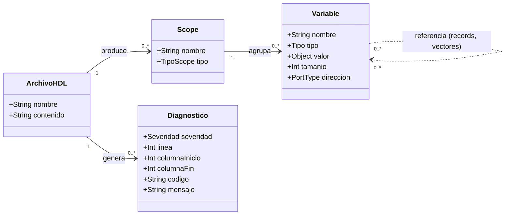

### `fig_5_8_1_seq_validacion_vhdl` — Validation sequence (rewritten)

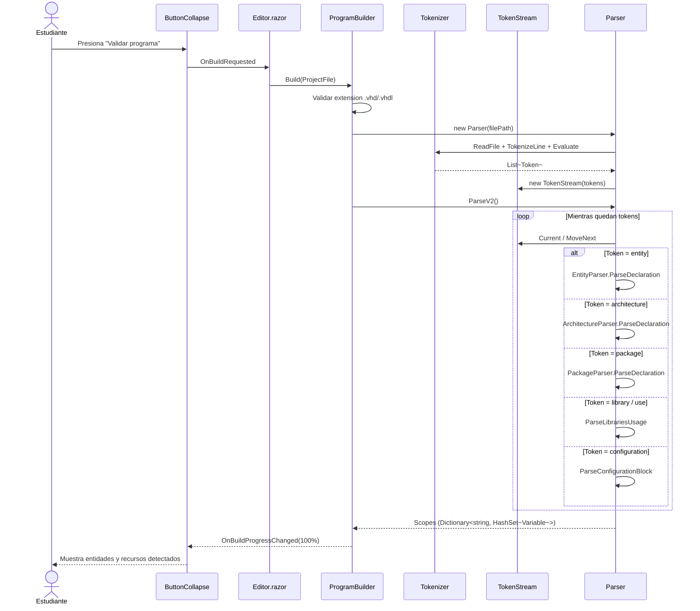

### `fig_5_11_2_1_act_validacion_prep` — Preparation activity (rewritten)

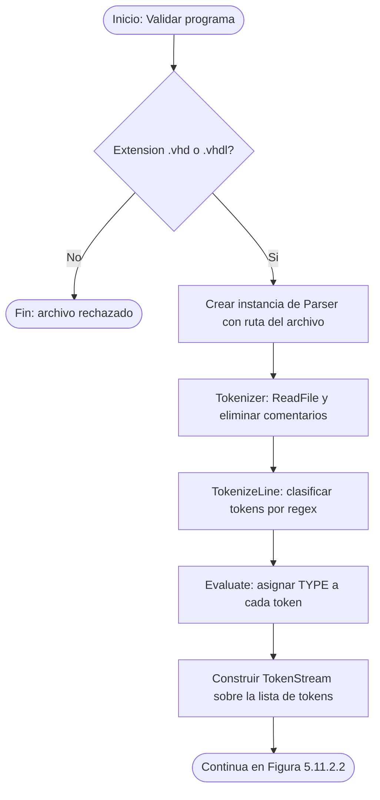

### `fig_5_11_2_2_act_validacion_recorrido` — Token-driven traversal (rewritten)

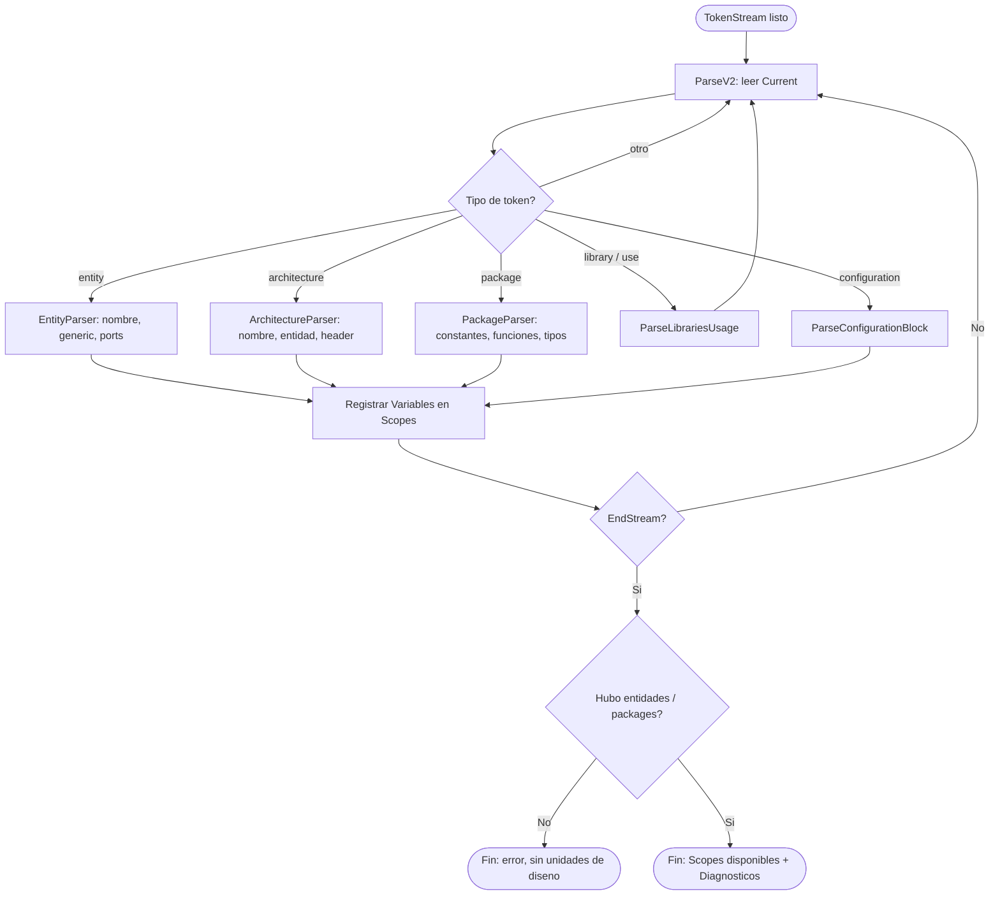

### `fig_5_11_6_act_tokenizer_pipeline` — Tokenizer pipeline (new)

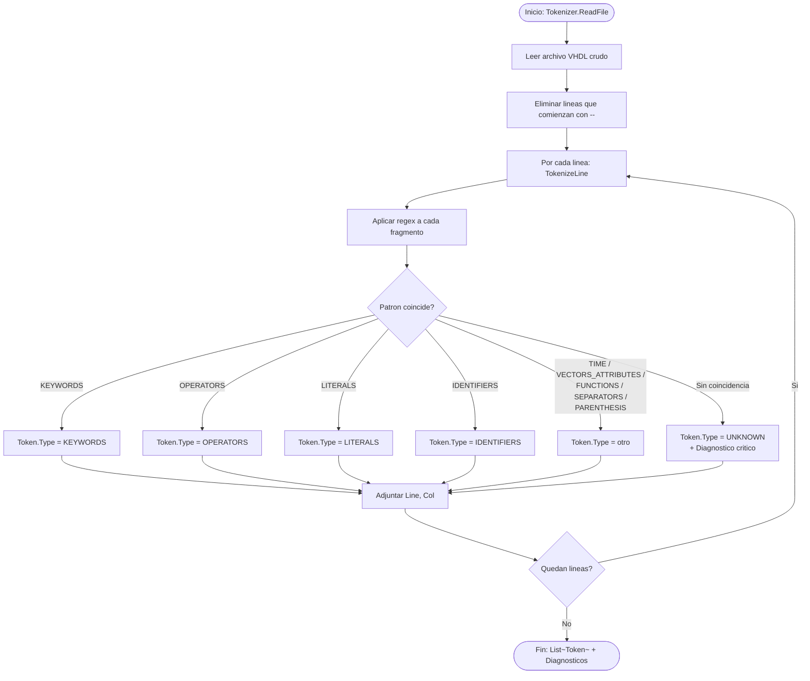

### `fig_5_11_7_act_configuration_block` — Configuration block parsing (new)

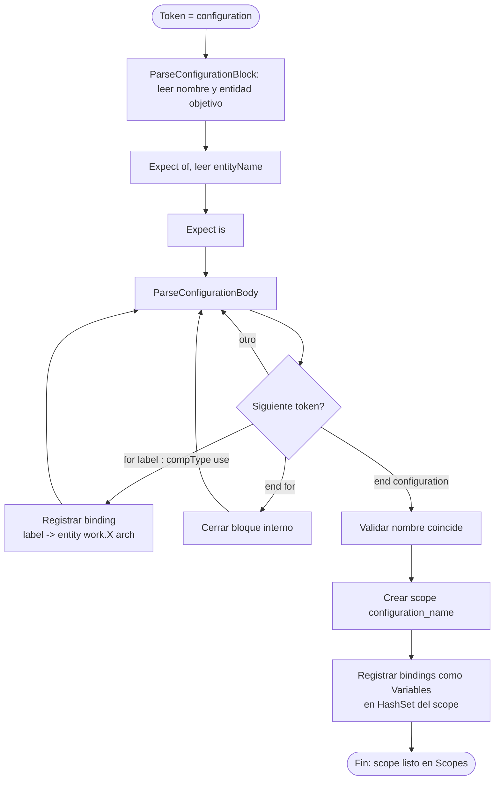

### `fig_5_11_8_act_generate_scope` — Generate statement scope lifecycle (new)

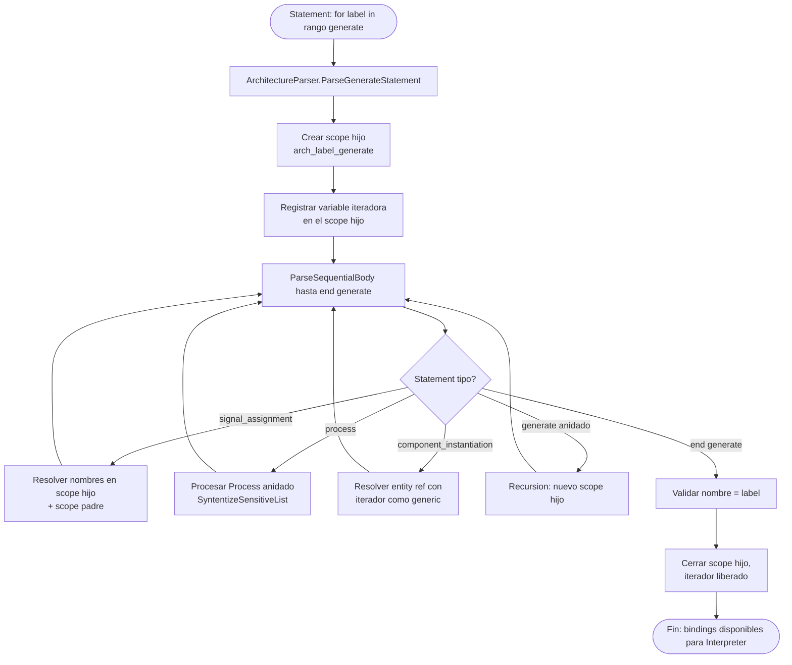

### `fig_5_11_9_act_record_types` — Record types resolution (new)

```mermaid
flowchart TD
    A([Declaracion: type T is record ...]) --> B[ArchitectureAssignationParser detecta record]
    B --> C[Crear Variable typeDef con<br/>CustomTypeName=T y RecordFields={}]
    C --> D[Por cada campo del record]
    D --> E[Leer nombre del campo + tipo]
    E --> F[RecordFields[name] = default por tipo]
    F --> G{Mas campos?}
    G -->|Si| D
    G -->|No| H[Registrar tipo T en scope]
    H --> I([Tipo disponible para declaraciones])

    J([Asignacion: signal x : T := ...]) --> K[Crear Variable x con<br/>CustomTypeName=T]
    K --> L[Copiar RecordFields del typeDef]
    L --> M([Variable lista en scope])

    N([Acceso: x.field <= value]) --> O[DataStructuresParser: detectar punto]
    O --> P[Resolver x en Scopes]
    P --> Q{Existe x.RecordFields[field]?}
    Q -->|No| R[Diagnostico: campo desconocido]
    Q -->|Si| S[Generar asignacion sobre<br/>RecordFields[field]]
    S --> T([Operacion lista para Interpreter])
```

---

## Changelog

### Version 1.14.0 (2026-04-19)

*   **Structured diagnostics** — new `Parser.Models.Diagnostic` type with
    `DiagnosticSeverity` (Info / Warning / Error) and line / column / code /
    message. `Diagnostic.FromException(ParserException)` adapts the existing
    exception-based flow into the new collection without breaking callers.
*   **Linter hook** — downstream callers (see `Debugger.Repositories.Parser`)
    can now run a non-fatal pass that reports missing `;` at statement ends
    and `begin` / `end` block imbalance *before* the full parser runs.
    Addresses the long-standing complaint that the parser silently accepted
    sources missing terminators at simulation time.
*   **Editor integration** — these diagnostics are mapped to Monaco's
    `setModelMarkers` API by `Kmila.Shared/Pages/Editor.razor`, so syntax
    errors now light up in the gutter instead of appearing only in a toast.
*   **Build hygiene** — added `<NoWarn>` for the XML-doc ripple
    (CS1587 / CS1591 / CS1570) caused by the comma-separated const lists in
    `Models/Constants.cs`. The project builds warning-free without the churn
    of splitting each regex constant into its own declaration.

---

## What's new in v1.15 (2 May 2026)

Parser surface now accepts:
- `procedure name(...) is ... end name;` in the architecture header (#12).
- Direct entity instantiation `label : entity work.Sub[(arch)] port map(...)` (#13).
- Generic defaults with arithmetic expressions, e.g. `TOTAL : integer := BASE * TIMES` (#16).
- Line numbers in error diagnostics now reference the user's source file (not the tokenizer's call counter) via the new `Tokenizer.TokenizeLineAt(text, sourceLineZeroBased)` overload (#21).

Memory: `Tokenizer.Evaluate()` now releases the raw `_tokens` buffer once `_typeDictionary` is built. Workstation GC enabled at the project level for low-RAM device targeting (#7).

Full release notes: [`Documentacion/CHANGELOG_v1.15.md`](../Documentacion/CHANGELOG_v1.15.md).

---

## Strictness pass (2026-05-17)

`PortsParser` now rejects two classes of port-declaration sloppiness that previously slipped through silently. Both were filed by Daniel as part of the ripple-counter "Visible Wave" repro that built clean despite obvious typos — see [`Documentacion/CHANGELOG_concepts_module_2026-05-17.md`](../Documentacion/CHANGELOG_concepts_module_2026-05-17.md) addendum and the memory entry `project_vhdl_parser_too_lenient.md`.

### Unknown port type → "did you mean …" error

When the type identifier in a port declaration is captured as an IDENTIFIER (not a recognised KEYWORD) AND its case-folded value is within Levenshtein-distance 2 of any canonical VHDL type name in `Constants.KNOWN_TYPE_NAMES`, the parser now throws a `ParserException` with a "Did you mean '<canonical>'?" hint. Catches the common slips:

| Source token | Canonical | Distance | Behaviour |
|---|---|---|---|
| `STDLOGIC` | `std_logic` | 1 (missing `_`) | **rejected** |
| `STD_LGIC` | `std_logic` | 1 (missing `O`) | **rejected** |
| `coefficient_array_t` | none close | > 2 | accepted as user-defined type |

The Levenshtein helper lives at `Constants.cs:LevenshteinDistance` (private, rolling two-row buffer). `Constants.FindTypoSuggestion(string)` is the public entry — pass the source identifier, get back the closest canonical name or `null` when the identifier looks legitimate.

### Missing `;` between ports

The `Parse()` loop now detects the case where a port declaration finishes and the next token is another IDENTIFIER (rather than `;` or `)`). It surfaces a `ParserException` reading "Missing ';' before port '<name>' in port declaration list." with the offending token's line + column — instead of letting the parse cascade into a confusing "expected )" message far below the actual problem.

### Negative test suite

`Program.cs` gained a second test pass for "must-fail" fixtures. Each entry is a `(filename, mustContainSubstring)` pair; a PASS means the parser surfaced the expected exception and the message contained the required substring. The runner's exit code is non-zero unless **both** the 40 positive AND every negative fixture pass — so regressions can't silently re-loosen the strictness.

Current negative coverage (Parser root, alongside the existing `test1..test40.vhdl`):

- `test_negative_unknown_type.vhdl` — typo `STDLOGIC` in a port type (must contain `STDLOGIC`).
- `test_negative_missing_port_semi.vhdl` — port lacks `;` before the next port (must contain `Missing ';'`).
- `test_negative_garbage_in_body.vhdl` — stray `$` token in the architecture body (must contain `Unexpected token '$'`).

Adding more is one entry in the `negativeTests` array + a `test_negative_*.vhdl` file at the Parser root.

---
*Last updated: 2026-08-03*