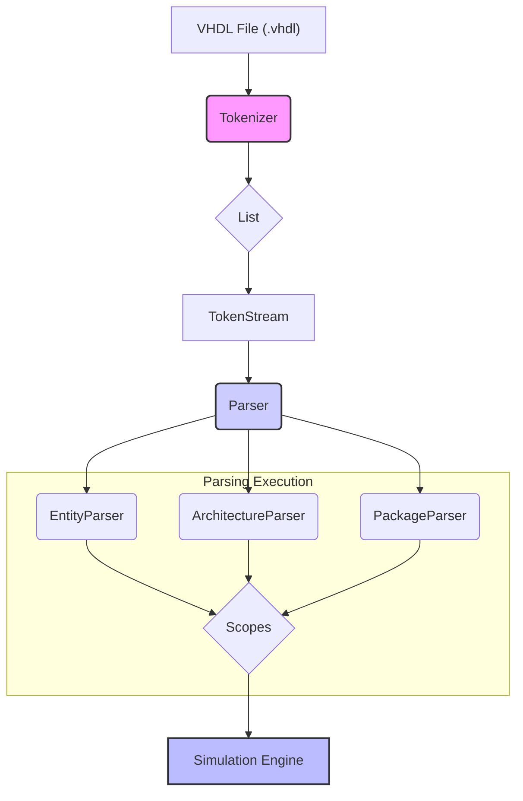
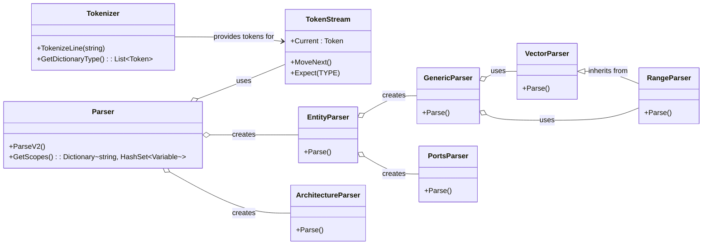
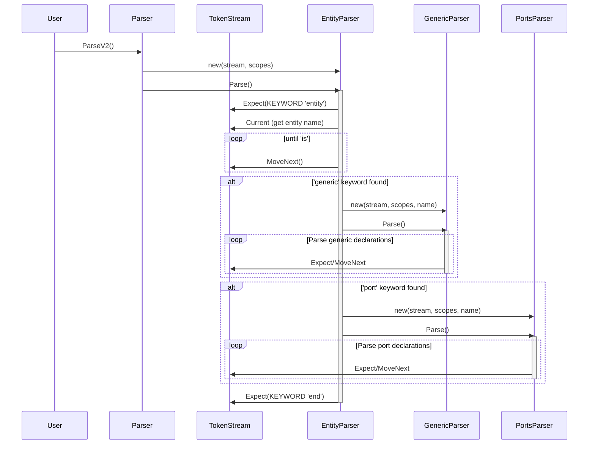
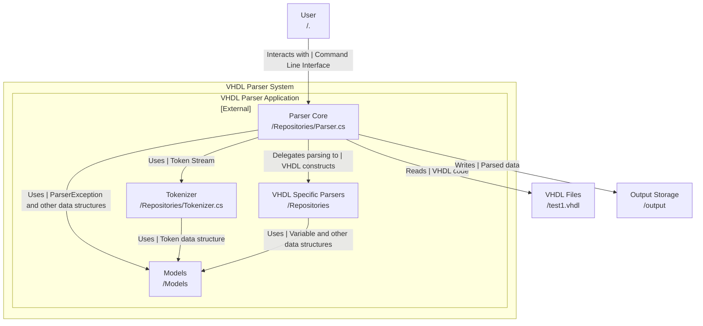

# VHDL Parser Module

## Project: Kmila-9s

This module is a core component of **Kmila-9s**, a project officially titled "Aplicación Multiplataforma para el Aprendizaje y Depuración de Código VHDL sin Requerimiento de Hardware Físico" (Multiplatform Application for Learning and Debugging VHDL Code without Requiring Physical Hardware).

**Author:** Ulrich Tamayo Daniel  
**Email:** dulricht1700@alumno.ipn.mx
**Email 2:** danielulrichtamayo@gmail.com

---

## 1. Project Overview

The primary goal of this project is to develop a free, open-source, and multiplatform desktop application for the interactive debugging of VHDL code. The application aims to facilitate the learning of digital design by providing a unified environment for simulation and real-time visualization of digital signals, clock cycles, and port states, completely eliminating the need for physical hardware like FPGAs.

### Key Motivations
*   **Accessibility:** Overcoming the financial barrier of expensive FPGA boards and proprietary software licenses.
*   **Pedagogical Improvement:** Offering an intuitive, integrated graphical interface that simplifies the debugging process, unlike the fragmented command-line workflows of tools like GHDL and GTKWave.
*   **Flexibility:** Providing a self-contained application that runs locally on multiple operating systems (Windows, macOS, Linux, Android, iOS) without requiring an internet connection.

This project is built using .NET and MAUI, ensuring a modern and maintainable codebase with broad platform support.

## 2. The Parser Module

This specific module, the **VHDL Parser**, serves as the foundational first step in the simulation pipeline. Its sole responsibility is to read raw VHDL source code (`.vhdl` files) and transform it into a structured, in-memory representation using C# classes. This structured data is then passed to the simulation engine for execution and analysis.

The parser is designed to be robust, handling complex VHDL syntax and providing clear error messages for invalid code.

### Core Responsibilities
*   **Lexical Analysis:** Breaking down the raw VHDL code into a stream of individual tokens (keywords, identifiers, operators, literals, etc.).
*   **Syntactic Analysis:** Validating the sequence of tokens against the VHDL grammar rules to understand the code's structure.
*   **Abstract Syntax Tree (AST) Generation:** Building a tree-like structure of C# objects that represents the VHDL design, including its entities, architectures, signals, processes, and sequential statements.
*   **Scope Management:** Tracking all declared identifiers (signals, variables, ports, etc.) and the scope in which they are valid (e.g., entity, architecture, process).

## 3. Architecture of the Parser Module

The parser is built with a modular, object-oriented design where different classes are responsible for parsing specific parts of the VHDL language.

### Key Components

*   **`Tokenizer.cs`**: The first stage of the pipeline. It reads a `.vhdl` file or a raw string, removes comments, and uses regular expressions to split the code into a list of raw string tokens. It then evaluates these tokens to classify them into types (e.g., `KEYWORD`, `IDENTIFIER`) and creates a list of `Token` objects.

*   **`TokenStream.cs`**: A wrapper around the list of `Token` objects generated by the `Tokenizer`. It provides a stream-like API (`Current`, `MoveNext`, `Expect`, `Match`) that allows the parser classes to easily consume and validate tokens in sequence.

*   **`Parser.cs`**: The main orchestrator. It initializes the `TokenStream` and delegates the parsing of top-level VHDL structures (`entity`, `architecture`, `package`) to their respective specialized parser classes.

*   **Structural Parsers (`IParseStructures`)**:
    *   **`EntityParser.cs`**: Parses an `entity` block, including its name and delegations for `generic` and `port` blocks.
    *   **`ArchitectureParser.cs`**: Parses an `architecture` block, including its header (signal/constant declarations) and body (processes, concurrent statements).
    *   **`PackageParser.cs`**: Parses `package` and `package body` declarations.

*   **Declaration Parsers (`IParseDeclarations`)**:
    *   **`PortsParser.cs`**: Handles the `port (...)` block within an entity, creating `Variable` objects for each port.
    *   **`GenericParser.cs`**: Handles the `generic (...)` block, parsing generic constants.
    *   **`ArchitectureAssignationParser.cs`**: Parses declarations in an architecture's header, such as `signal` and `constant`.

*   **Statement & Expression Parsers**:
    *   **`DataStructuresParser.cs`**: A versatile parser for sequential statements found inside processes, functions, and architecture bodies. It can parse `if`, `case`, `for` loops, and signal/variable assignments.
    *   **`VectorParser.cs` & `RangeParser.cs`**: Helper parsers that handle specific syntax for vector types (e.g., `std_logic_vector(7 downto 0)`) and ranges (e.g., `integer range 0 to 255`).

### Core Data Models

*   **`Token.cs`**: Represents a single lexical unit from the source code. It contains its `Value` (e.g., "entity", "clk"), `Type` (e.g., `KEYWORDS`), and location (`Line`, `Col`).

*   **`Variable.cs`**: A crucial class that represents any named object in VHDL (a signal, port, variable, or constant). It stores its `Name`, data `Type`, `Value`, and `Size`. It also includes an `OnValueChange` event to notify the simulation engine of updates.

*   **`Constants.cs`**: A static class that centralizes all constants used by the parser, including:
    *   `enum TYPE`: Defines all possible token types.
    *   `enum DATATYPES`: Defines all supported VHDL data types.
    *   Regular expressions for identifying each token type.

*   **`ParserException.cs`**: A custom exception class used to report detailed syntax and semantic errors during parsing, including the location of the error.

## 4. How to Use This Module

To use the parser, you instantiate the main `Parser` class, providing it with the path to a VHDL file. Then, you call the `ParseV2()` method to begin the process.

```csharp
using Parser.Repositories;
using System;

try
{
    // 1. The Tokenizer reads the file and performs lexical analysis.
    Tokenizer tokenizer = new("path/to/your/design.vhdl");

    // 2. The Parser class orchestrates the syntactic analysis.
    Parser vhdlParser = new(tokenizer);
    vhdlParser.ParseV2();

    // 3. After parsing, the results are available in the Scopes dictionary.
    // This dictionary contains all entities, architectures, and their declared variables.
    var scopes = vhdlParser.GetScopes();

    Console.WriteLine("Parsing completed successfully!");

    // You can now inspect the parsed data structures.
    foreach (var scope in scopes)
    {
        Console.WriteLine($"Scope: {scope.Key}");
        foreach (var variable in scope.Value)
        {
            Console.WriteLine($"  - Variable: {variable.Name}, Type: {variable.Type}");
        }
    }
}
catch (Exception ex)
{
    Console.WriteLine($"An error occurred during parsing: {ex.Message}");
}
```

## 5. Dependencies

This module relies on the following .NET libraries:
*   `Microsoft.Extensions.Logging`: For logging information and errors during the parsing process.

All other code is self-contained within this project module.

## 6. Parser Flow and Class Relationships

To better understand the parser's internal workings, the following diagrams illustrate the data flow, class relationships, and sequence of operations.

### 6.1. High-Level Parsing Flow

This diagram shows the overall process, starting from the raw VHDL file and ending with the structured `Scopes` dictionary that the simulation engine can use.



### 6.2. Detailed Class Diagram

This diagram details the composition and inheritance relationships between the key classes in the parser module. It highlights how specialized parsers are composed to handle different parts of the VHDL syntax.



### 6.3. Sequence Diagram: Parsing an Entity

This sequence diagram shows the runtime interactions between objects when the `ParseV2()` method encounters an `entity` block in the VHDL code.



## 6. Module Diagram

---
*Generated by [CodeViz.ai](https://codeviz.ai) on 10/30/2025, 4:20:47 PM*